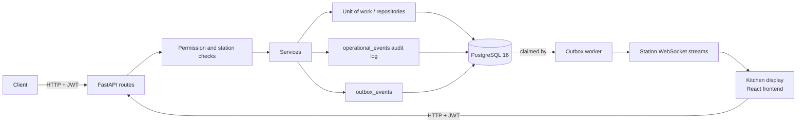

# RestaurantOS

[](https://github.com/ArturLy263/restaurant-os/actions/workflows/ci.yml)

Backend for restaurant order, kitchen and billing workflows, plus a kitchen display (KDS) frontend,
designed from my experience working in restaurant kitchens. It is a portfolio project, not a
production system.

## What it does today

- **Orders → kitchen → bill → payment** through a versioned REST API (FastAPI, `/api/v1`), with
  preparation states `PENDING → IN_PROGRESS → READY → SERVED`.
- **PostgreSQL data model** managed with SQLAlchemy 2 and Alembic migrations; migration tests check
  upgrade/downgrade round-trips and that models match the migrated schema.
- **Data integrity under concurrency:** writes lock the order row (`SELECT … FOR UPDATE`);
  concurrency tests coordinate real connections through PostgreSQL's lock graph.
- **Idempotency keys** for payments and other mutations, committed in the same transaction as the
  business change.
- **Role-based permissions** (waiter, kitchen, bar, cashier, manager) and per-station access.
- **Audit trail:** order, kitchen and billing actions are recorded in `operational_events` with the acting user.
- **Transactional outbox:** domain events are written in the same transaction as the change; a
  delivery worker claims them with `FOR UPDATE SKIP LOCKED`, retries with backoff, dead-letters after
  repeated failures and keeps each order's events in order. Event payloads are versioned contracts.
- **Station event streams:** authenticated, station-scoped WebSockets that push outbox events to
  kitchen and bar displays.
- **Tenant consistency:** database triggers keep each restaurant's records apart; central status
  rules backed by CHECK constraints.
- **Kitchen display** ([`frontend/`](frontend/README.md), React + TypeScript + Vite): sign-in, station
  queue, start / ready / serve, live updates with reconnect; unit and component tests (Vitest) and a
  headless-Chrome test against a mock API.
- **CI** (GitHub Actions): backend unit, integration and migration suites against a PostgreSQL 16
  service; frontend type check, tests and production build.

Not built yet: APIs for menu, table, user and role management; printers; inventory; analytics;
deployment.



## Quick start

```bash
cp .env.example .env              # then edit the values
docker compose up -d postgres
python3.14 -m venv .venv && source .venv/bin/activate
pip install -r backend/requirements-test.txt -c backend/constraints.txt
alembic upgrade head
python backend/seed.py            # once, on an empty database
uvicorn app.main:app --app-dir backend --reload   # docs at http://127.0.0.1:8000/docs
pytest -m unit                    # no database needed
```

## Project layout

```text
alembic.ini                 Alembic configuration (run alembic from the repo root)
docker-compose.yml          PostgreSQL 16 for local development (port 5433)
pytest.ini                  pytest configuration and test markers
backend/app/                FastAPI application (entry point: app.main:app)
backend/app/realtime/       station event streams (WebSocket hub, fan-out)
backend/alembic/            database migrations
backend/requirements.txt    pinned runtime dependencies
backend/requirements-test.txt  pinned test dependencies (includes runtime)
backend/constraints.txt     exact versions of all transitive dependencies
backend/seed.py             demo data for an empty database (run once)
backend/tests/              test suite
backend/app/workers/        outbox delivery worker
frontend/                   kitchen display (React + TypeScript), see frontend/README.md
scripts/                    maintenance scripts
.github/workflows/ci.yml    CI: backend unit, integration and migration tests; frontend checks
```

## Development setup

Requirements: Python 3.14 and Docker. All commands run from the
repository root.

1. Create a virtual environment and install the dependencies:

   ```bash
   python3.14 -m venv .venv
   source .venv/bin/activate
   pip install -r backend/requirements-test.txt -c backend/constraints.txt
   pip check
   ```

   To run the API only, `backend/requirements.txt` is enough. The
   constraints file pins every transitive dependency to the versions the
   project is tested with.

2. Configure the environment and adjust the values:

   ```bash
   cp .env.example .env
   ```

   | Variable | Used for |
   | --- | --- |
   | `POSTGRES_USER`, `POSTGRES_PASSWORD`, `POSTGRES_DB` | the Docker PostgreSQL container |
   | `DATABASE_URL` | the API, Alembic and seed script (development database) |
   | `JWT_SECRET_KEY` | signing access tokens; use a long random value |
   | `ADMIN_PASSWORD` | password of the demo admin created by `seed.py` |
   | `TEST_DATABASE_URL` | optional, see [Tests](#tests) |

   Environment variables take precedence over `.env`.
   `REQUIRE_TEST_DATABASE` (see [Tests](#tests)) is read from the
   environment only.

3. Start PostgreSQL:

   ```bash
   docker compose up -d postgres
   ```

4. Apply the migrations to the development database:

   ```bash
   alembic upgrade head
   alembic current
   ```

5. Load the demo data (restaurant, admin user, menu, tables, kitchen
   station, modifiers):

   ```bash
   python backend/seed.py
   ```

   > **Warning:** `seed.py` is not safe to run repeatedly. Run it
   > **once**, on a freshly migrated, empty database. It always inserts a
   > new demo restaurant and never checks for or updates existing data:
   > on an already seeded database it aborts with a duplicate-key error
   > for `admin@restaurantos.com` (and rolls back), and on a database
   > with other data but no demo admin it adds another demo restaurant
   > next to it. To start over, use a fresh database.
   > (`backend/seed_modifiers.py` only adds the burger modifiers to
   > databases seeded before `seed.py` included them.)

6. Start the API:

   ```bash
   uvicorn app.main:app --app-dir backend --reload
   ```

   Check it with `curl http://127.0.0.1:8000/health`; the interactive API
   docs are at <http://127.0.0.1:8000/docs>. Log in as
   `admin@restaurantos.com` with `ADMIN_PASSWORD`.

   The API delivers outbox events to station displays only with
   `OUTBOX_WEBSOCKET_DELIVERY=true` (see
   [Station event streams](#station-event-streams)); otherwise events
   stay in the outbox until a worker delivers them.

## API conventions

### Errors

Every error response, whatever its status, has the same body:

```json
{
  "detail": "Payment exceeds remaining bill amount",
  "error": {
    "code": "PAYMENT_EXCEEDS_AMOUNT_DUE",
    "message": "Payment exceeds remaining bill amount",
    "request_id": "3f2b8c1e9d4a4f0b8e6c2a7d5b1e0f93"
  }
}
```

- `error.code` is stable; program against it. The full list is
  `ErrorCode` in `backend/app/core/errors.py` (e.g. `ORDER_NOT_FOUND`,
  `TABLE_NOT_AVAILABLE`, `BILL_NOT_OPEN`, `ORDER_HAS_UNSENT_ITEMS`).
  Errors raised by the framework get a code from their status
  (`NOT_FOUND`, `NOT_AUTHENTICATED`, ...).
- `error.message` is for people and may change.
- `detail` is kept for compatibility with existing clients. It equals
  `message`, except for request validation errors (422,
  `VALIDATION_ERROR`), where it is still FastAPI's list of field errors.
- Unexpected failures return 500 `INTERNAL_ERROR` with the message
  `Internal server error`; the exception is logged on the server, never
  returned.
- Every response, successful or not, has an `X-Request-ID` header, equal
  to `error.request_id` on errors and included in the server log line of
  unexpected errors. A client may send its own `X-Request-ID` (1-128
  characters from `A-Z a-z 0-9 . _ : -`); anything else is replaced by a
  generated ID.

Status codes: 400/422 for invalid input, 401 for missing or invalid
credentials, 403 when the user's role lacks the permission
(`PERMISSION_DENIED`) or the order belongs to another user, 404 for
missing resources and for other restaurants' resources, 409 when the
current state forbids the operation.

### Money values

The target contract is a decimal string with two decimals for every
monetary value (`"12.50"`). Today:

- Bill and payment amounts follow it: `subtotal`, `total`,
  `adjustments_total`, `adjusted_total`, `paid_total`, `amount_due`,
  adjustment `amount` and payment `amount` are strings such as `"15.00"`.
- Order item `unit_price` and `total_price` and item modifier `price`
  are still JSON numbers (`12.5`). They are exact (stored as
  `NUMERIC(10, 2)`), but clients should not do arithmetic on them as
  floats; bill amounts are the source of truth for totals. They become
  strings in Stage 2, together with the first client that shows prices.
- The payment request `amount` should be sent as a string (`"15.00"`);
  JSON numbers are still accepted, and more than two decimals is rejected
  with 422.

Field-by-field inventory and the transition plan:
`docs/monetary-contract.md`.

### Roles and permissions

Every endpoint except `POST /api/v1/auth/login`, `GET /health` and
`GET /api/v1/me` requires a permission, checked on the backend for each
request. A user's permissions come from their role: the `roles` row of
their restaurant whose `name` is one of the codes below (exact, upper
case). The role is read from the database on every request, so changing a
user's role takes effect without a new token.

| Permission | Endpoints | WAITER | KITCHEN | BAR | CASHIER | MANAGER, ADMIN |
| --- | --- | :-: | :-: | :-: | :-: | :-: |
| `orders:create` | `POST /orders` | ✓ | | | | ✓ |
| `orders:add_items` | `POST /orders/{id}/items` | ✓ | | | | ✓ |
| `orders:send` | `POST /orders/{id}/send` | ✓ | | | | ✓ |
| `orders:view` | `GET /orders/{id}` | ✓ | | | ✓ | ✓ |
| `orders:cancel_items` | `POST /orders/{id}/items/{item_id}/cancel` (unbilled items) | ✓ | | | | ✓ |
| `orders:void` | `POST /orders/{id}/void` | ✓ | | | | ✓ |
| `orders:manage_all` | modify orders created by others (see below) | | | | | ✓ |
| `preparations:view` | `GET /stations`, `GET /stations/{id}/preparations` | | ✓ | ✓ | | ✓ |
| `preparations:update` | `POST /preparations/{id}/start`, `/ready` | | ✓ | ✓ | | ✓ |
| `preparations:serve` | `POST /preparations/{id}/serve` | ✓ | ✓ | ✓ | | ✓ |
| `preparations:all_stations` | every station, not only assigned ones (see below) | ✓ | | | | ✓ |
| `preparations:discard` | `POST /preparations/{id}/discard` (paid orders only, see below) | | | | | ✓ |
| `bills:create` | `POST /bills/order/{order_id}` | | | | ✓ | ✓ |
| `bills:adjust` | `POST /bills/{id}/items/{item_id}/cancel`; voiding a billed order | | | | ✓ | ✓ |
| `bills:view` | `GET /bills/{id}` | | | | ✓ | ✓ |
| `payments:create` | `POST /bills/{id}/payments` | | | | ✓ | ✓ |
| `events:view` | `GET /events` | | | | | ✓ |
| `menu:manage`, `tables:manage` | none yet | | | | | ✓ |

(Paths are under `/api/v1`.) `ADMIN` is the administrator role created by
`seed.py`; it has every permission, like `MANAGER`. The policy lives in
`backend/app/core/permissions.py`.

- A missing permission is 403 `PERMISSION_DENIED`
  (`"Missing permission: payments:create"`). It is checked before the
  endpoint looks anything up, so it reveals nothing about the resource.
- A role name that is not listed (e.g. `SOMMELIER` or `waiter`), or a role
  of another restaurant, grants no permissions.
- Adding items to, sending, cancelling items of and voiding an order is
  limited to the user who created it (403 `ORDER_ACCESS_DENIED`), unless
  the user has `orders:manage_all` (managers). Viewing is not: any user
  with `orders:view` sees every order of the restaurant. The override only
  lifts the creator rule; every state and financial rule still applies.
- Once an order has a bill, its items are cancelled only through the
  bill: `POST /bills/{bill_id}/items/{item_id}/cancel` (`bills:adjust`)
  records an `ITEM_CANCELLATION` adjustment; the bill's original total
  never changes, and the bill must be open and unpaid, as before. The
  order endpoint answers 409 `ORDER_BILLED` for billed orders, for every
  role, so it can never change an issued bill. Voiding an order that has
  a bill (which voids the bill) also requires `bills:adjust`, so in
  practice a manager.
- Preparations move `PENDING → IN_PROGRESS → READY → SERVED`; anything
  else is 409 `INVALID_PREPARATION_TRANSITION`. Waiters may only serve
  (`READY → SERVED`). Transitions lock the order, like cancellations, so
  a cancelled preparation cannot be revived.
- Audit events record the user who acted (`user_id`); events about an
  order also record its creator as `order_created_by` in their metadata.
- Another restaurant's orders, bills, stations and preparations are
  reported exactly like missing ones (404), never as 403.
- Kitchen and bar users work only the stations assigned to them (see
  [Station scope](#station-scope)).

There is no API to manage roles or users yet; `seed.py` creates only the
`ADMIN` role. Other roles are `roles` rows with the codes above.

#### Station scope

A user without `preparations:all_stations` (in practice `KITCHEN` and
`BAR`) may view a station's queue and move its preparations only for
stations assigned to them in the `station_assignments` table. An
assignment counts only if the station

- belongs to the user's restaurant,
- is active (`stations.is_active`), and
- has the type of the user's role: `KITCHEN` users need `KITCHEN`
  stations, `BAR` users `BAR` stations (`stations.type`).

Anything else grants nothing: a Kitchen or Bar user without assignments
has no stations, and assignment rows of other roles are ignored.
Managers, admins and waiters (who serve dishes from every station) have
`preparations:all_stations`. Assignments are read on every request, so
adding or removing one applies immediately.

Outside their scope, the queue and every transition answer 403
`STATION_ACCESS_DENIED`. The queue checks the scope before looking the
station up, so unassigned, missing and other restaurants' stations get
the same answer; a preparation of another restaurant stays 404.

There is no API for assignments yet. Until there is, add them with SQL on
the database in question:

```sql
INSERT INTO station_assignments (user_id, station_id)
SELECT u.id, s.id
FROM users u
JOIN stations s ON s.restaurant_id = u.restaurant_id
WHERE u.email = 'cook@example.com' AND s.name = 'Kitchen';

-- and to remove one:
DELETE FROM station_assignments
WHERE user_id = (SELECT id FROM users WHERE email = 'cook@example.com');
```

`GET /api/v1/me` returns the authenticated user, for clients deciding what
to show:

```json
{
  "id": "6c1e…",
  "name": "Ana",
  "email": "ana@example.com",
  "restaurant_id": "0f3a…",
  "role": {"id": "9d2b…", "name": "CASHIER"},
  "permissions": ["bills:create", "bills:view", "orders:view", "payments:create"],
  "stations": []
}
```

`role` is `null` if the user's role belongs to another restaurant;
`permissions` is empty for an unrecognized role. `stations` lists the
stations whose preparations the user may work (`{id, name, type}`, only
valid assignments): `null` means every station, `[]` none.

#### Station list

`GET /api/v1/stations` (`preparations:view`) lists, by name, the stations
whose queue the user may view: every station of the restaurant for users
with `preparations:all_stations` (inactive ones included, as their
queues stay viewable), otherwise only the valid assignments of the
[station scope](#station-scope), possibly none. Other restaurants'
stations are never listed.

```json
[
  {"id": "3f9a…", "name": "Bar", "type": "BAR", "is_active": true},
  {"id": "e7d2…", "name": "Kitchen", "type": "KITCHEN", "is_active": true}
]
```

#### Station queue

`GET /api/v1/stations/{station_id}/preparations` lists the station's open
preparations (`PENDING`, `IN_PROGRESS`, `READY`), oldest first, with what
a kitchen or bar display shows:

```json
[
  {
    "id": "5b0e…",
    "order_item_id": "a41c…",
    "station_id": "e7d2…",
    "status": "PENDING",
    "created_at": "2026-10-19T12:00:00.123456",
    "started_at": null,
    "ready_at": null,
    "order_id": "c93f…",
    "table_number": 4,
    "table_name": "Terrace",
    "product_name": "Burger",
    "quantity": 2,
    "modifiers": [
      {"modifier_id": "1d8a…", "name": "Bacon"},
      {"modifier_id": "77b0…", "name": "Cheese"}
    ],
    "order_status": "SENT",
    "bill_status": null
  }
]
```

`modifiers` are the names stored when the item was added (sorted by
name), and so is `product_name` (`order_items.product_name_snapshot`,
migration `a3d9e7c1f5b2`): renaming a product does not change work already
ordered. Items added before that migration have no stored name and show
the product's current name; they are not backfilled. Order responses
expose the stored name as `items[].product_name` (`null` for those older
items). `table_name` may be `null`. Prices are not
included. `order_status` is the order's status and `bill_status` its
bill's (`null` before the order is billed).

#### Payment is not service

The final payment closes the order (`CLOSED`, bill `PAID`) even while
some of its preparations are unfinished: paying never waits for the
kitchen, and payment never marks anything served. Those preparations stay
in the station queue, with `order_status` `CLOSED` (displays mark them as
paid), and continue through start, ready and serve as usual. Nothing
expires or is hidden automatically.

If such a dish will never be served (e.g. the guest left), a manager
discards it:

```bash
curl -X POST http://127.0.0.1:8000/api/v1/preparations/$PREPARATION_ID/discard \
  -H "Authorization: Bearer $TOKEN" -H "Content-Type: application/json" \
  -d '{"reason": "Guest left before the dish was served"}'
```

- Needs `preparations:discard` (MANAGER and ADMIN only); `reason` is
  required (1-500 characters) and recorded in the
  `preparation.discarded` audit event, never in outbox events.
- The preparation becomes `CANCELLED` and leaves the queue. Its order item
  (`SENT`) and the paid bill are unchanged: there is no refund or bill
  adjustment.
- 409 `ORDER_NOT_CLOSED` unless the order is fully paid and `CLOSED`
  (including after a partial payment); before that, items are cancelled
  through the order or bill instead. 409 `INVALID_PREPARATION_TRANSITION`
  for a preparation that is already `SERVED` or `CANCELLED`. Another
  restaurant's preparation is 404 `PREPARATION_NOT_FOUND`.
- Like every preparation change it locks the order first, so it cannot
  overtake a payment in progress, and a serve queued behind it gets 409.

#### Stations when sending

Sending an order routes each new item to its product's station, which
must belong to the order's restaurant and be active. Sending is all or
nothing: one item that cannot be routed rejects the whole send.

- 409 `PRODUCT_HAS_NO_STATION`: the product has no station, or its
  station belongs to another restaurant (reported the same way, so
  nothing about the other restaurant is revealed).
- 409 `STATION_INACTIVE` (`"Station Bar is inactive"`): the station is
  deactivated. Adding such an item is still allowed; it can be sent once
  the station is active again.

### Idempotency keys

These mutations accept an `Idempotency-Key` header:

| Operation | Endpoint |
| --- | --- |
| Open an order for a table | `POST /api/v1/orders` |
| Add an item to an order | `POST /api/v1/orders/{order_id}/items` |
| Send an order's new items | `POST /api/v1/orders/{order_id}/send` |
| Cancel an order item (no bill yet) | `POST /api/v1/orders/{order_id}/items/{item_id}/cancel` |
| Cancel a billed item (bill adjustment) | `POST /api/v1/bills/{bill_id}/items/{item_id}/cancel` |
| Void (cancel) an order | `POST /api/v1/orders/{order_id}/void` |
| Create (or fetch) the order's bill | `POST /api/v1/bills/order/{order_id}` |
| Take a payment (closes the order when fully paid) | `POST /api/v1/bills/{bill_id}/payments` |
| Start, finish or serve a preparation | `POST /api/v1/preparations/{preparation_id}/start\|ready\|serve` |
| Discard a paid order's preparation | `POST /api/v1/preparations/{preparation_id}/discard` |

Clients should generate a new key (e.g. a UUID) for each operation and
reuse it only when retrying that same operation, for example after a
timeout or a lost connection.

```bash
curl -X POST http://127.0.0.1:8000/api/v1/bills/$BILL_ID/payments \
  -H "Authorization: Bearer $TOKEN" \
  -H "Idempotency-Key: 0b6f2a52-6d3e-4f61-a3c5-2b8f1f4c9e10" \
  -H "Content-Type: application/json" \
  -d '{"amount": "15.00", "method": "CARD"}'
```

- **Without a key** the request behaves exactly as before: no
  deduplication. A retried add-item adds the item again and a retried
  payment is a second payment (if the bill allows it); a retried send,
  void or preparation step gets a 409. The key is optional so
  existing clients keep working; new clients should always send it.
- **Format:** 1-255 printable ASCII characters without spaces; otherwise
  400 `IDEMPOTENCY_KEY_INVALID`.
- **Scope:** keys belong to the authenticated user within their
  restaurant. The same key from another user or restaurant is a different
  key and never returns someone else's result.
- **Same key, same request:** the operation is not run again. The
  response is the stored status code and body of the first request,
  with an extra `Idempotent-Replayed: true` header. "Same request" means
  the same method, endpoint, path parameters and body; JSON key order and
  amount formatting (`15`, `"15.0"`, `"15.00"`) do not matter.
- **Same key, different request:** 422 `IDEMPOTENCY_KEY_REUSED`, every
  time, and nothing is run. This status is a deliberate contract (owner
  decision 2026-10-30), not 409: 409 in this API means the current state
  forbids the operation, while a reused key is an invalid request that a
  retry can never fix.
- **Concurrent requests with the same key:** the second waits until the
  first finishes, then gets its stored result. The operation runs once.
- **When the operation fails:** only successful (2xx) results are stored.
  An error response (e.g. 409) or a crash rolls back the business change
  and the key together, so nothing is stored and a retry with the same key
  runs the operation again against the current state. A request waiting on
  a failed one runs the operation itself.
- **Atomicity:** the business change, its audit events, the key and the
  stored response are committed in one database transaction. A committed
  change always has its stored result, and a stored result always belongs
  to a committed change.
- **Lifetime:** stored results are kept for at least 24 hours. After that
  the key may be used again as a new key (expired records are replaced
  when their key is reused; there is no background purge yet).
- A replay returns the result as it was, not the current state: replaying
  a send does not send items added since. Use a new key for the next send.

### Concurrency guarantees

- Writes to an order, its items, its bill and its payments lock the order
  row first (`SELECT ... FOR UPDATE`), so they apply one at a time.
- Opening an order locks the table row. A table has at most one active
  (`OPEN` or `SENT`) order: a concurrent second request gets 409
  `TABLE_NOT_AVAILABLE` (or `TABLE_HAS_ACTIVE_ORDER` if the table is
  marked available while an order is still active). Once the order is
  `CLOSED` (fully paid) or `CANCELLED` (voided) the table is free again.
- This is enforced by the lock, not by a unique index: existing
  development databases can contain several active orders for one table
  from before this rule, and a migration must not fail on them or rewrite
  them. Such tables stay `OCCUPIED` and simply reject new orders until
  their orders are closed or voided.

### Status rules

`backend/app/core/states.py` lists every status and every allowed status
change of orders, order items, preparations, bills and tables (payments
and bill adjustments have one status each):

| Record | Changes |
| --- | --- |
| order | `OPEN → SENT`, `SENT → SENT` (later rounds), `OPEN/SENT → CANCELLED` (void), `SENT → CLOSED` (final payment) |
| order item | `ADDED → SENT`, `ADDED/SENT → CANCELLED` |
| preparation | `PENDING → IN_PROGRESS → READY → SERVED`, `PENDING/IN_PROGRESS → CANCELLED` (item cancelled), `READY → CANCELLED` (discard) |
| bill | `OPEN → PAID`, `OPEN → VOID` |
| table | `AVAILABLE → OCCUPIED`, `OCCUPIED/AVAILABLE → AVAILABLE` |

Each operation still checks its own business rules first and answers with
its specific error (`ORDER_BILLED`, `INVALID_PREPARATION_TRANSITION`, ...).
Every status write then goes through the rules, which refuse any other
change: a missing or wrong guard fails the request with a 500 and rolls it
back instead of storing an impossible state. The preparation changes are
exactly those the `preparation.status_changed` contracts describe (v2; v1
without `READY → CANCELLED`).

PostgreSQL enforces each vocabulary with a CHECK constraint
`ck_<table>_status` (migration `f4c2a8d6b1e3`). The upgrade changes no
rows; if a table already holds another status it stops before adding any
constraint and names the table and values, to be reviewed by hand.

### Tenant consistency

Every record belongs to one restaurant, and PostgreSQL triggers (migration
`e1b7d3a9c4f2`) reject rows that would link two restaurants:

| Table | Rule | Constraint name in the error |
| --- | --- | --- |
| `preparations` | the station belongs to the order's restaurant | `ck_preparations_station_restaurant` |
| `order_items` | the product (through its category) belongs to the order's restaurant | `ck_order_items_product_restaurant` |
| `products` | the station, if set, belongs to the category's restaurant | `ck_products_station_restaurant` |

A violation is a `check_violation`; the API checks these rules itself
first, so the triggers are a backstop. They fire on `INSERT` and on
`UPDATE OF` the linking columns only: rows written before the migration
are not re-validated, and other updates of them (e.g. a status change)
keep working. The upgrade logs existing violating rows as warnings and
changes no data. Changing the `restaurant_id` of an order, station or
category is not checked.

### Transactional outbox

Selected mutations also write an integration event to the
`outbox_events` table, for later delivery to kitchen/bar displays and
other consumers. `published_at` stays `NULL` until the delivery worker
below has delivered the event.

The outbox is separate from the audit history. `operational_events`
records who did what, for people; `outbox_events` is delivery data for
systems, carries no actor and no free text, and has no HTTP endpoint;
station displays receive their events through
[station event streams](#station-event-streams).

| Event type | Version | Written when | Payload |
| --- | --- | --- | --- |
| `order.sent` | 1 | an order's new items are sent (`POST /orders/{id}/send`) | `order_id`, `table_id`, `initial`, `items[]`: `order_item_id`, `preparation_id`, `station_id`, `product_id`, `quantity` |
| `preparation.status_changed` | 1 | a preparation is started, ready or served, cancelled with its item, or discarded while `PENDING`/`IN_PROGRESS` | `preparation_id`, `order_id`, `order_item_id`, `station_id`, `previous_status`, `status` |
| `preparation.status_changed` | 2 | a `READY` preparation of a paid order is discarded (`READY`->`CANCELLED`) | same as v1 |

Every event has a stable `id` (consumers deduplicate on it), its
`event_type` and `schema_version`, the `restaurant_id` it belongs to, its
aggregate (`aggregate_type` `order`, `aggregate_id` the order) and
`created_at`.

#### Event contracts

Each (`event_type`, `schema_version`) pair has one payload model in
`backend/app/schemas/outbox.py`, listed in `CONTRACTS`. `event_type` says
what happened and never changes meaning; `schema_version` numbers the
shape and rules of that type's payload. The envelope (the columns above)
comes from the contract, so `aggregate_id` is always the payload's
`order_id`.

A payload is valid only if it is exactly the canonical JSON of its model:
strict JSON types (`2`, not `"2"` or `2.0`; `true`, not `1`), lower-case
hyphenated UUIDs, no missing or unknown fields, and the version's rules.
v1 requires `quantity` >= 1 and at least one sent item, each item and
preparation once, and only the five transitions it describes
(`PENDING`->`IN_PROGRESS`->`READY`->`SERVED`, `PENDING`/`IN_PROGRESS`->
`CANCELLED`). `preparation.status_changed` v2 has the same fields and
also allows `READY`->`CANCELLED`; producers write the lowest version that
describes a change, so only discarding a ready dish produces v2. Every
event is checked to parse back before it is written;
one that does not fails the change (500) like any outbox failure.

Consumers call `parse_payload(event_type, schema_version, payload)`:

- `UnsupportedEventError`: the pair is not known to this consumer (e.g. a
  newer version during a rolling deploy). It is not malformed; skip or
  park it, never guess its fields.
- `InvalidEventPayloadError`: a known pair whose payload breaks its
  contract. Its message names the failing fields, never their values.

Both derive from `EventContractError`. The delivery worker does not
parse payloads: it delivers any committed event, so a consumer's version
support never dead-letters events or blocks an order.

Compatibility rules for changing a contract:

- **Same version:** documentation, or a new optional field consumers of
  that version may ignore. Payloads forbid unknown fields, so every
  consumer of the version must be updated first; when in doubt, add a
  version.
- **New version** (a new model next to the old one): renaming, removing,
  retyping or making a field required, changing a field's meaning, and
  widening or narrowing allowed values (a new status or transition).
  Producers switch to it only once consumers support it.
- **Never:** editing or removing a version while its events may still be
  stored or undelivered, or rewriting stored payloads. A new meaning is a
  new `event_type`, not a new version.
- Event types are added only together with a consumer.

`backend/tests/unit/test_event_contracts.py` holds a golden payload per
contract; they must keep parsing and dumping unchanged.

- **Atomic:** the event is written in the same transaction as the change
  it describes (and its audit events and Idempotency-Key result). A
  rollback leaves neither; if the event cannot be written, the change
  fails (500) and nothing is committed.
- **Once per change:** a rejected request (404, 403, 409, ...) writes no
  event, and an Idempotency-Key replay does not run the operation again,
  so it writes no second event.
- **Order:** an order's events are written under its row lock, and
  `created_at` is taken at insert time (`clock_timestamp()`), so ordering
  one order's events by `created_at` follows the order the changes were
  committed in. There is no global order across orders.
- Events are not backfilled for changes made before the table existed.

#### Delivery worker

`app.workers.outbox_worker` hands committed events to a publisher. Nothing
starts it automatically: importing the application runs no background
work. Run it as its own process, from `backend/`:

```bash
cd backend
python -m app.workers.outbox_worker            # deliver until SIGINT/SIGTERM
python -m app.workers.outbox_worker cleanup    # delete old delivered events, then exit
```

On SIGINT or SIGTERM the worker finishes the event it is delivering (at
most the publish timeout), stops, closes its database connections and
exits with status 0. Its connections show up in `pg_stat_activity` as
`application_name = 'restaurantos-outbox-worker'`. An invalid setting
stops it before it connects. In code, `OutboxWorker(engine, publisher,
...)` offers `process_batch()` (one bounded pass) and `run(stop_event)`.

A publisher is any object with `publish(message)`: returning means
delivered, raising means not. The standalone runner uses
`LoggingPublisher`, which logs event metadata (never payloads); the API
process uses `StationEventPublisher` to deliver to station displays (see
[Station event streams](#station-event-streams)). While
`OUTBOX_WEBSOCKET_DELIVERY` is enabled the standalone `run` command
refuses to start (exit status 2), so the two never split the events
between them; `cleanup` is unaffected.

Settings (environment or `.env`; out-of-range values are rejected):

| Variable | Default | Allowed | Meaning |
| --- | --- | --- | --- |
| `OUTBOX_WORKER_BATCH_SIZE` | 100 | 1-1000 | events per batch |
| `OUTBOX_WORKER_POLL_INTERVAL_SECONDS` | 1.0 | >0-300 | pause when there is nothing to do |
| `OUTBOX_WORKER_RESTAURANT_ID` | unset (all) | a UUID | deliver/clean up only this restaurant's events |
| `OUTBOX_MAX_ATTEMPTS` | 10 | 1-100 | failed attempts before an event is dead-lettered |
| `OUTBOX_PUBLISH_TIMEOUT_SECONDS` | 30 | >0-300 | how long to wait for one publisher call |
| `OUTBOX_RETENTION_DAYS` | 7 | 1-3650 | `cleanup` deletes events delivered longer ago |
| `OUTBOX_CLEANUP_BATCH_SIZE` | 1000 | 1-10000 | rows deleted per cleanup transaction |

- **One event per transaction:** the worker claims one due, undelivered,
  not dead-lettered event with `SELECT ... FOR UPDATE SKIP LOCKED`, calls
  the publisher while holding the row lock, and sets `published_at` only
  after the publisher returned. Concurrent workers skip claimed rows, so
  an event is never handed to two publishers at the same time.
- **At least once, not exactly once:** if the worker dies between a
  successful publish and its commit, the event stays undelivered and is
  published again. Consumers must deduplicate on the event `id`.
- **Failures:** a failed attempt increments `attempts`, sets
  `last_attempt_at`, stores the exception type and message (truncated to
  1000 characters) in `last_error`, and delays the next attempt
  (`next_attempt_at`: 5 s, doubling, at most 5 minutes). A batch tries
  each event at most once. Logs name the event and the exception type,
  never the payload or the exception message.
- **Dead letters:** the `OUTBOX_MAX_ATTEMPTS`-th failed attempt sets
  `dead_lettered_at` instead of a retry time. A dead-lettered event is
  never retried automatically, keeps its id and payload, and is logged at
  ERROR level. It stays undelivered, so **it keeps holding back every
  later event of its order** (other orders are not affected). There is no
  recovery tooling yet; do not edit these rows by hand without a decided
  recovery policy.
- **Publish timeout:** the publisher runs in a separate thread, and the
  worker stops waiting for it after `OUTBOX_PUBLISH_TIMEOUT_SECONDS`.
  Python cannot interrupt a blocking call, so **a timed-out call is not
  cancelled**: it is abandoned and may still complete, and deliver, later.
  The attempt is recorded as failed (`PublishTimeout` in `last_error`),
  which releases the row lock; the event is retried, so a late-completing
  call can produce a duplicate (at least once). While an abandoned call is
  still running the worker claims no events, so it never has more than one
  publisher call in flight. The timeout bounds how long the worker waits
  and holds a row lock, not how long the publisher runs.
- **Order:** an event is not claimed while an older event of the same
  order is undelivered (claimed elsewhere, waiting for a retry, failing or
  dead-lettered), so each order's events are delivered in order.
- **Tenants:** each message carries its event's `restaurant_id`;
  `OUTBOX_WORKER_RESTAURANT_ID` limits a worker to one restaurant. The
  worker only updates the delivery columns, never an event's type,
  version, scope, aggregate or payload.

Inspecting dead letters and stuck events (read-only):

```sql
-- Dead-lettered events, newest first
SELECT id, restaurant_id, event_type, aggregate_id, attempts,
       last_attempt_at, dead_lettered_at, last_error
FROM outbox_events
WHERE dead_lettered_at IS NOT NULL
ORDER BY dead_lettered_at DESC;

-- Events held back behind a dead letter of the same order
SELECT later.id, later.event_type, later.aggregate_id, later.created_at
FROM outbox_events dead
JOIN outbox_events later
  ON later.aggregate_type = dead.aggregate_type
 AND later.aggregate_id = dead.aggregate_id
 AND (later.created_at, later.id) > (dead.created_at, dead.id)
 AND later.published_at IS NULL
WHERE dead.dead_lettered_at IS NOT NULL;
```

`last_error` holds the exception message of the publisher, so read it
with the same care as the payload.

**Retention:** `cleanup` deletes events delivered more than
`OUTBOX_RETENTION_DAYS` ago (never less than one day), oldest delivery
first, in transactions of at most `OUTBOX_CLEANUP_BATCH_SIZE` rows (each
selects up to that many ids `FOR UPDATE SKIP LOCKED`, then deletes
exactly those ids), at most `--max-batches` (default 100) per run. Undelivered and
dead-lettered events are never deleted. It runs only when invoked, e.g.
from cron: `cd backend && python -m app.workers.outbox_worker cleanup`.

### Station event streams

Kitchen and bar displays receive their station's outbox events over a
WebSocket, `/api/v1/stations/{station_id}/events`, one connection per
station. Code: `backend/app/realtime/` (`stream.py` protocol, `hub.py`
connections, `publisher.py` routing, `delivery.py` worker thread).

#### Running

Delivery to streams runs **inside the API process**, because that is
where the connections are:

```bash
# API with station event delivery (one process, no --workers N)
OUTBOX_WEBSOCKET_DELIVERY=true uvicorn app.main:app --app-dir backend

# Retention cleanup stays a separate command, e.g. from cron
cd backend && python -m app.workers.outbox_worker cleanup
```

The application's lifespan starts one `OutboxWorker` thread
(`outbox-station-delivery`, using the `OUTBOX_*` settings of the delivery
worker) when the server starts, and stops it on shutdown after the event
being delivered. Importing `app.main` starts nothing, and with the
setting off (the default) no events are delivered by the API. Do not run
`python -m app.workers.outbox_worker run` at the same time (it refuses to
start), and do not enable delivery in more than one API process: each
process only knows its own connections, so events claimed by one process
never reach displays connected to another. Spreading connections over
several processes needs a shared broker, which this design deliberately
does not have.

#### Authentication

1. Open the WebSocket. Within `WEBSOCKET_AUTH_TIMEOUT_SECONDS` send, as
   the first (text) message:

   ```json
   {"type": "authenticate", "token": "<access token from POST /api/v1/auth/login>"}
   ```

   The token is the same as `Authorization: Bearer` on HTTP. It is never
   put in the URL (browsers cannot set headers on WebSockets, and URLs
   end up in access logs) and never logged. Tokens without an expiry are
   refused for streams.
2. The server answers `{"type": "subscribed", "station_id": "..."}` or
   closes the connection (codes below). Anything the client sends later
   is ignored; there is no way to change station on a connection.

#### Authorization

A stream is authorized exactly like `GET /api/v1/stations/{station_id}/
preparations`, by the same code: the user must be active and have
`preparations:view` (Kitchen, Bar, Manager, Admin; not Waiter or
Cashier); a user without `preparations:all_stations` only gets stations
in their [station scope](#station-scope), checked before the station is
looked up; and the station must belong to the user's restaurant. Tenant,
role and stations are read from the database, never from the client.

An open stream is authorized again every
`WEBSOCKET_REAUTH_INTERVAL_SECONDS` (default 30), so a deactivated user,
a changed role or, for station-scoped users, a removed assignment or a
deactivated station closes it within that time (as on HTTP, users with
`preparations:all_stations` may view inactive stations); it is closed
when the token expires.

| Close code | Reason | Meaning |
| --- | --- | --- |
| 4401 | `NOT_AUTHENTICATED` | no, malformed, invalid or expired token; auth timeout |
| 4403 | `USER_INACTIVE`, `PERMISSION_DENIED`, `STATION_ACCESS_DENIED` | as the HTTP 403 with that code |
| 4404 | `STATION_NOT_FOUND` | no such station in the user's restaurant (all-station users) |
| 4429 | `SLOW_CONSUMER` | the client fell `WEBSOCKET_QUEUE_SIZE` messages behind |
| 1013 | `TOO_MANY_CONNECTIONS` | the process has `WEBSOCKET_MAX_CONNECTIONS` streams |

#### Messages

```json
{"type": "event", "id": "<outbox event id>", "event_type": "order.sent",
 "schema_version": 1, "aggregate_type": "order", "aggregate_id": "<order id>",
 "created_at": "2026-10-19T12:00:00.123456+00:00", "payload": {"...": "..."}}

{"type": "resync_required", "reason": "UNSUPPORTED_EVENT",
 "event_id": "...", "event_type": "...", "schema_version": 3}
```

`payload` follows the [event contract](#event-contracts) of its type and
version. Routing never leaves the event's restaurant:
`preparation.status_changed` goes to the preparation's station only;
`order.sent` goes to each station with items in that round, each getting
an `order.sent` with **only its own items**. Nothing is broadcast to the
whole restaurant except `resync_required`, which carries no payload.

#### Delivery semantics

- **Delivered is not received.** The outbox marks an event delivered once
  it is in the buffers of the streams open in this process at that
  moment, possibly none. A display that is offline, reconnecting or was
  disconnected misses those events. **After every (re)connect a display
  must reload its queue with `GET /api/v1/stations/{id}/preparations`,
  then apply events** (see [Client synchronization](#client-synchronization)).
  A successful WebSocket send is not proof that the display processed or
  stored anything.
- **At least once.** The same event can arrive twice with the same `id`
  (worker crash after delivering, timed-out delivery): deduplicate on
  `id`.
- **Order.** One order's events arrive in the order they were committed
  (the worker delivers each order's events in order; each stream is
  FIFO). There is no order across orders.
- **Unsupported versions.** An `(event_type, schema_version)` this API
  version does not support cannot be routed, so it is not sent. Every
  open stream of the restaurant gets `resync_required` (reload over
  HTTP), the event is marked delivered and a warning is logged: no retry
  loop, no dead letter, no blocked order.
- **Malformed payloads** of a supported version (a producer bug) fail the
  delivery: the worker retries with backoff and dead-letters the event
  after `OUTBOX_MAX_ATTEMPTS`. No stream receives it, and it holds back
  its order's later events (see [Delivery worker](#delivery-worker) for
  inspecting dead letters). There is no recovery operation, deliberately
  not over the API, until its authorization is designed.
- **Slow clients** are disconnected (4429) once `WEBSOCKET_QUEUE_SIZE`
  messages are waiting for them, instead of buffering without limit;
  other clients and the worker are not slowed down.

| Variable | Default | Allowed | Meaning |
| --- | --- | --- | --- |
| `OUTBOX_WEBSOCKET_DELIVERY` | false | true/false | run delivery to streams in this API process |
| `WEBSOCKET_AUTH_TIMEOUT_SECONDS` | 10 | >0-60 | time to send the authenticate message |
| `WEBSOCKET_REAUTH_INTERVAL_SECONDS` | 30 | >0-3600 | how often open streams are re-authorized |
| `WEBSOCKET_QUEUE_SIZE` | 100 | 1-10000 | messages buffered per stream before 4429 |
| `WEBSOCKET_MAX_CONNECTIONS` | 500 | 1-100000 | streams per API process before 1013 |

#### Client synchronization

A display keeps its station queue correct by combining one HTTP load
with the stream. On every connection:

1. Connect, authenticate, and **wait for `subscribed`**. The server
   registers the connection for the station's events just before sending
   it, so every event delivered from then on reaches the connection
   (after `subscribed`).
2. Then load the queue with `GET /api/v1/stations/{id}/preparations`
   (open preparations: `PENDING`, `IN_PROGRESS`, `READY`). Loading it
   before `subscribed` can miss an event delivered in between; loading it
   after cannot: an event delivered before the subscription was committed
   before the load, so the queue already reflects it, and every event
   delivered later reaches this connection.
3. **Events arrive while and after the queue loads**, and some of them
   are already reflected in it: an event committed before the load may
   still be waiting for delivery. Buffer the events received during the
   load, then apply them, and every later one, in arrival order.

Apply events idempotently and reconcile them with the loaded state; never
assume an event is new:

- Deduplicate on the event `id`. Keep the recently applied ids across
  reconnects (a bounded set is enough): an event can be delivered again,
  also to a later connection.
- Key everything by `preparation_id`. `order.sent` adds its items as
  `PENDING` preparations unless they are already present; it carries ids
  and quantities only, so reload the queue for what a display shows
  (product, table, modifiers). `preparation.status_changed` (v1 or v2)
  sets that preparation's status; `SERVED` and `CANCELLED` remove it from
  the queue.
- An event whose `previous_status` differs from the preparation's current
  status, or that names a preparation not in the queue, is already
  reflected in the loaded queue (or concerns a preparation that has left
  it): ignore it. One order's events arrive in commit order, so an event
  newer than the loaded queue always continues from the status shown.
  When in doubt, reload the queue instead of guessing.

Start over with a fresh queue load (step 2) whenever the state may have
diverged:

- **`resync_required`**: the stream stays open; reload the queue, and
  buffer and reconcile the events that arrive meanwhile as above.
- **Any close or network loss** (4429, 1013, 1012 on a server restart,
  a dropped connection): reconnect with backoff, wait for `subscribed`,
  reload. Events delivered while disconnected are not sent again.
- **4401**: log in again for a fresh token, then reconnect. **4403** and
  **4404** do not go away by retrying: the user's access or the station
  changed.

#### Local development and testing

- With `OUTBOX_WEBSOCKET_DELIVERY=true` against your development
  database, the API marks that database's outbox events delivered (it
  writes the delivery columns only). Leave it off unless you are trying
  the displays.
- The tests never use the development database:
  `backend/tests/integration/test_station_event_stream.py`
  (authentication, scope, revocation, cleanup) and
  `test_station_event_fanout.py` (routing, ordering, unsupported and
  malformed events, slow clients, the in-process runner) use committed
  data in the test database; `backend/tests/unit/test_station_event_hub.py`,
  `test_station_event_publisher.py` and `test_station_delivery_lifespan.py`
  (delivery is stopped off the event loop at shutdown) need no database.
- uvicorn needs a WebSocket protocol library to accept upgrades;
  `wsproto` is pinned in `backend/requirements.txt`.

## Tests

```bash
pytest                    # everything
pytest -m unit            # no database needed
pytest -m integration     # uses the PostgreSQL test database
pytest -m migrations      # migration round-trips on a disposable database
```

Every test is marked automatically from the fixtures it uses: tests that
use the test database are `integration`, tests that use a disposable
migration database are `migrations`, all others are `unit`. Markers are
strict, so a misspelled marker fails collection.

### Test databases

Tests never touch the development database.

- **Integration tests** use a separate database named after
  `DATABASE_URL` with `_test` appended (e.g. `restaurant_os_test`), or
  `TEST_DATABASE_URL` if set; the name must end with `_test`. It is
  created and migrated automatically, and each test runs in a transaction
  that is rolled back. Concurrency tests
  (`backend/tests/integration/test_mutation_concurrency.py`) need real
  commits on separate connections instead: they commit their own
  restaurant to the test database and delete everything it owns
  afterwards. They order concurrent requests by holding row locks and
  waiting on PostgreSQL's lock graph (`pg_blocking_pids`), not on timers
  (see `backend/tests/concurrency.py`).
- **Migration tests** create a new, empty database on the same server
  under a random name (`restaurantos_disposable_<random>_test`), tagged
  with a random token. Before migrating or dropping it they verify that
  the connection really reaches that database and carries that token, and
  they drop it afterwards, also when a test fails. The user in
  `TEST_DATABASE_URL` therefore needs the `CREATEDB` privilege (the Docker
  default user has it). If a run is killed, a leftover
  `restaurantos_disposable_*_test` database can be dropped by hand.

### When PostgreSQL is unavailable

By default, database tests are **skipped** when PostgreSQL is unreachable,
so `pytest -m unit` and quick local runs work without Docker. Read the
skip summary: a green run with skipped database tests did not test the
database.

Set `REQUIRE_TEST_DATABASE=1` to make database tests mandatory: an
unreachable server, or any skipped `integration`/`migrations` test, then
fails the run. CI always sets it.

```bash
REQUIRE_TEST_DATABASE=1 pytest
```

### Migration checks

`pytest -m migrations` verifies on a disposable database that

- the migration history has a single head,
- upgrading from an empty database to head and downgrading back to base
  works, leaving the schema empty,
- every migration's downgrade exactly reverses its upgrade (tables,
  keys, indexes, CHECK constraints, triggers and functions),
- the SQLAlchemy models match the migrated schema (the equivalent of
  `alembic check`),
- the status CHECK constraints allow exactly the statuses of
  `app/core/states.py`.

The model comparison uses Alembic autogenerate and has its limits: it
compares tables, columns, types, nullability, indexes, unique constraints
and foreign keys, but not server defaults, CHECK constraints, triggers,
sequences or anything created with raw SQL, and it cannot verify data
migrations. A renamed column appears as a drop plus an add. Review
generated migrations by hand.

To create a migration after changing a model:

```bash
alembic revision --autogenerate -m "describe the change"
```

## Continuous integration

`.github/workflows/ci.yml` runs on pushes to `main` and `public-main` and
on pull requests, with Python 3.14 and a PostgreSQL 16 service container.
It installs the pinned dependencies, runs `pip check`, the unit tests
without a database, a negative check that a missing test database fails
the run, the integration tests and the migration tests, all with
`REQUIRE_TEST_DATABASE=1`. A separate `frontend` job (Node 22) installs
exactly the lockfile (`npm ci`), type-checks, runs the Vitest suite and
builds the production bundle; the headless-Chrome test (`npm run e2e`) is
run locally only. CI uses only throwaway credentials for the job-local
database and needs no secrets.

## Updating dependencies

Edit the pins in `backend/requirements*.txt`, then regenerate the
constraints from a fresh environment:

```bash
python3.14 -m venv /tmp/restaurantos-deps
/tmp/restaurantos-deps/bin/pip install -r backend/requirements-test.txt
/tmp/restaurantos-deps/bin/pip check
/tmp/restaurantos-deps/bin/pip freeze
```

Replace the package lines of `backend/constraints.txt` with the
`pip freeze` output and run the full test suite.
