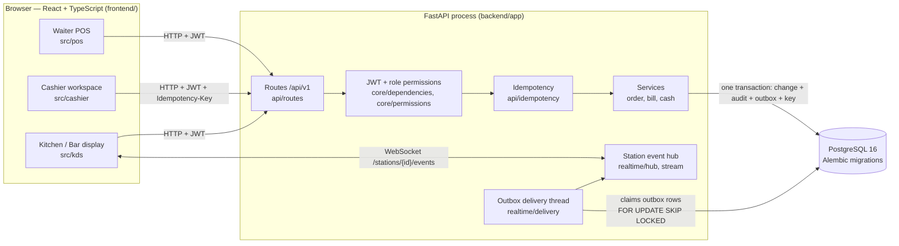
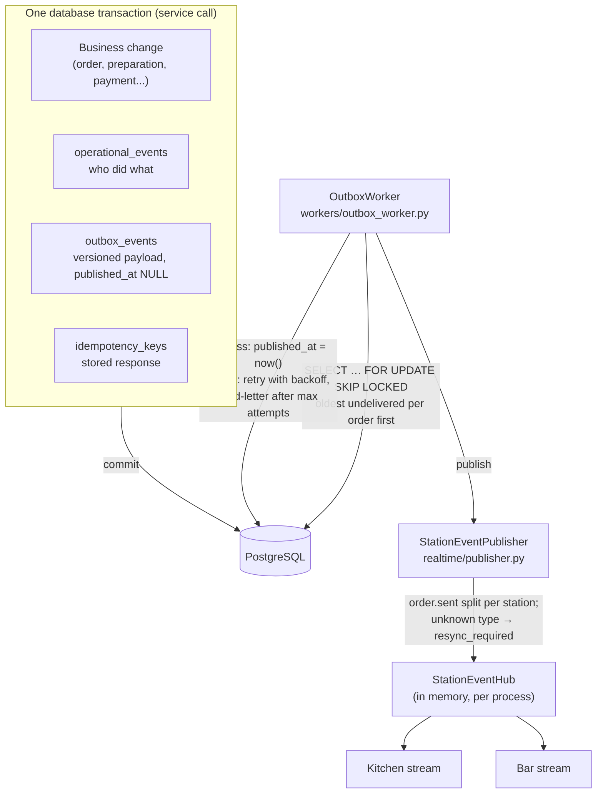
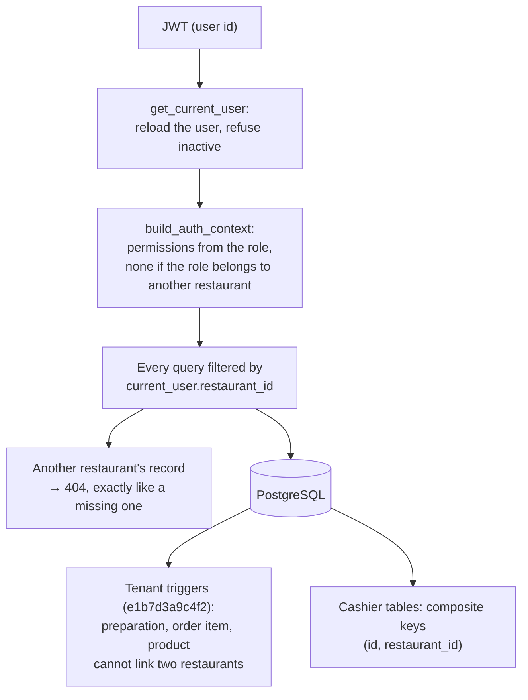

# Architecture

A short tour of how RestaurantOS is built. Each section points at the code
that implements it; the [ADRs](adr/) explain why. The detailed API
contracts (errors, idempotency, status rules, outbox, event streams) are in
the root [README](../README.md#api-conventions).

## 1. System overview



- **Frontend:** one Vite app. After sign-in, `GET /api/v1/me` returns the
  user's permissions and the app offers only the screens they allow
  (`App.tsx: availableModes`): the waiter POS, the KDS, the cashier
  workspace, or a switch between them for managers. In development Vite
  proxies `/api`, WebSockets included, so there is no CORS.
- **Backend:** routes stay thin. They check a permission with
  `require_permission`, wrap writes in the idempotency dependency, and call
  a service. Services hold the business rules, lock rows, write audit and
  outbox records, and commit through `db/unit_of_work.py`.
- **Live updates:** with `OUTBOX_WEBSOCKET_DELIVERY=true`, one API process
  runs the outbox delivery thread, which feeds the in-memory station hub.
  Without it the KDS falls back to reloading every 20 s.

## 2. Order to payment, end to end

```mermaid
sequenceDiagram
    autonumber
    actor W as Waiter (POS)
    actor K as Kitchen / Bar (KDS)
    actor C as Cashier
    participant API as FastAPI
    participant DB as PostgreSQL
    participant D as Outbox delivery

    W->>API: POST /orders (table, guests) + key
    API->>DB: lock table, order OPEN, table OCCUPIED
    W->>API: POST /orders/{id}/items (product, modifiers) + key
    W->>API: POST /orders/{id}/send + key
    API->>DB: items SENT, one preparation per item,<br/>outbox "order.sent" (same transaction)
    D->>DB: claim undelivered event (SKIP LOCKED)
    D-->>K: WebSocket event → queue reloads
    K->>API: POST /preparations/{id}/start, /ready
    API->>DB: status change + outbox "preparation.status_changed"
    D-->>K: live status change
    W->>API: POST /preparations/{id}/serve + key
    C->>API: GET /cashier/orders?view=payable
    C->>API: POST /bills/order/{order_id} + key
    C->>API: GET /bills/{id}/split?parts=2
    C->>API: POST /bills/{id}/payments (CASH share) + key
    C->>API: POST /bills/{id}/payments (CARD share, card_confirmed) + key
    API->>DB: lock order, open day + open shift,<br/>payment rows; final payment: bill PAID,<br/>order CLOSED, table AVAILABLE
```

Every payment requires an open business day and an open cash shift
(`bill_service._lock_open_day_and_shift`). The amount due is always the
server's `Bill.amount_due`. The equal split is computed by the server to
the cent, and each share is paid as an ordinary payment.

## 3. Transactional outbox and station streams



- An event exists only if its change committed, and a committed change
  always has its event (`services/outbox_service.py` only adds rows to the
  caller's transaction).
- Payloads are versioned contracts (`schemas/outbox.py`); the worker does
  not interpret them, the publisher does.
- Per order (the aggregate), events are delivered in order: an event
  waits while an older undelivered event of the same order exists.
- Clients deduplicate on the event id and reload the queue after every
  `subscribed` and on `resync_required` (`frontend/src/kds/stationLive.ts`).

## 4. Tenant isolation



The restaurant is never taken from the request. It comes from the
signed-in user's row. The services check ownership first, and the
database refuses cross-restaurant links as a backstop. The cashier schema
(`d9e4b2a7c6f1`) adds `(id, restaurant_id)` unique keys for composite
references. Station access is narrower still: kitchen and bar staff work
only their assigned, active stations of their station type.

## 5. Cash ledger and blind count

```mermaid
stateDiagram-v2
    [*] --> DayOpen: POST /business-days
    state DayOpen {
        [*] --> NoShift
        NoShift --> ShiftOpen: POST /cash/shifts (counted opening cash)
        ShiftOpen --> ShiftOpen: payments, refunds,<br/>cash in / out
        ShiftOpen --> Closed: POST …/close or …/handover<br/>(blind count, recorded as entered)
        Closed --> Closed: POST …/closing-explanation<br/>(if the count differs)
        Closed --> ShiftOpen: next cashier counts and opens<br/>= handover (another person;<br/>a difference is explained afterwards)
        Closed --> NoShift
    }
    DayOpen --> DayClosed: POST /business-days/{id}/close<br/>(no open shift, no active order,<br/>every difference explained)
    DayClosed --> [*]: report frozen in closing_summary
```



- **Ledger rows** (payments, allocations, refunds, cash movements, opening
  corrections, closings, handovers) are append-only. Database triggers
  refuse updates and deletes, and refuse inserts outside an open shift of
  an open day (`d9e4b2a7c6f1`, `f2a8c6e4b1d9`). Partial unique indexes
  allow one open business day per restaurant and one open shift per
  register.
- **Expected cash** is derived, never stored on the shift. It is the
  effective opening amount, plus cash sales and cash tips, plus cash in,
  minus cash out and cash refunds (`services/cash_ledger.py: drawer`).
- **Blind count:** the closing cashier sends only the counted amount.
  The server computes the difference under the shift lock and records the
  count as entered: no refusal depends on the expected cash, so retrying
  can never reveal it. A non-zero difference is explained afterwards
  (`…/closing-explanation`, append-only `cash_count_explanations`), and the
  day cannot close until it is. Expected cash and differences are returned
  only with `cash_drawer:view_expected` (managers), and the cashier UI
  checks the same permission. See [security](security.md).
- **Two-person handover:** the outgoing cashier closes with their count.
  The incoming cashier confirms by opening the next shift with the cash
  they count, which records a handover between the two shifts. The same
  person may not do both, unless they hold
  `cash_handovers:self_confirm`, and then the handover is marked
  self-confirmed. A received count that differs is recorded as entered and
  explained afterwards (`…/handover-explanation`).
- **Closing the day** is refused while a shift is open, any order is still
  active, or a counted difference is unexplained (the response lists them;
  a database trigger enforces the last one too). The day report is then frozen
  in `business_days.closing_summary`.
